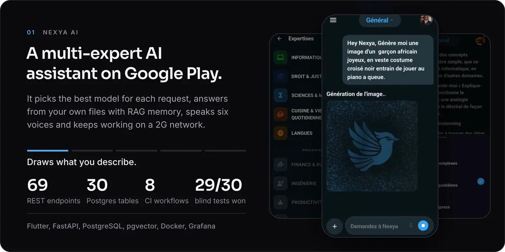
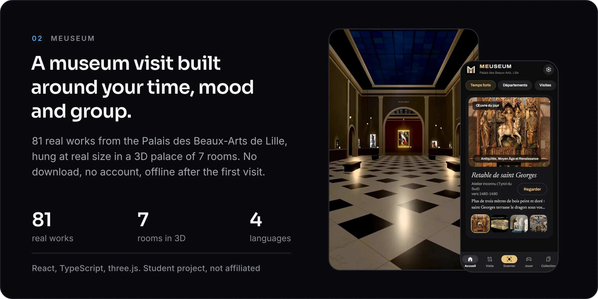
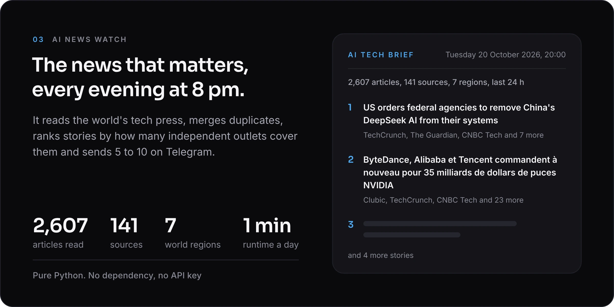

<a href="https://lothngassa.com/en/">
<picture>
  <source media="(prefers-color-scheme: dark)" srcset="https://raw.githubusercontent.com/lothngassa/lothngassa/main/assets/hero-dark.svg">
  <source media="(prefers-color-scheme: light)" srcset="https://raw.githubusercontent.com/lothngassa/lothngassa/main/assets/hero-light.svg">
  
</picture>
</a>

 

I build products end to end, from the database schema to the app in the store. I trained as a software engineer at the École Nationale Supérieure Polytechnique de Douala (4th out of 126) and I am now specialising in Data and AI at JUNIA ISEN, in Lille. I founded [Nexyalabs](https://nexyalabs.com).

I never ship code I cannot explain and repair on my own.

 

<a href="https://lothngassa.com/en/projets/nexya/">
<picture>
  <source media="(prefers-color-scheme: dark)" srcset="https://raw.githubusercontent.com/lothngassa/lothngassa/main/assets/nexya-dark.webp">
  <source media="(prefers-color-scheme: light)" srcset="https://raw.githubusercontent.com/lothngassa/lothngassa/main/assets/nexya-light.webp">
  
</picture>
</a>

<a href="https://play.google.com/store/apps/details?id=com.nexyalabs.nexya"><b>Google Play</b> ↗</a>&emsp;
<a href="https://nexyalabs.com">nexyalabs.com ↗</a>&emsp;
<a href="https://lothngassa.com/en/projets/nexya/">Case study ↗</a>

 

<a href="https://lothngassa.com/en/projets/meuseum/">
<picture>
  <source media="(prefers-color-scheme: dark)" srcset="https://raw.githubusercontent.com/lothngassa/lothngassa/main/assets/meuseum-dark.webp">
  <source media="(prefers-color-scheme: light)" srcset="https://raw.githubusercontent.com/lothngassa/lothngassa/main/assets/meuseum-light.webp">
  
</picture>
</a>

<a href="https://meuseum.pages.dev"><b>Open MEUSEUM</b> ↗</a>&emsp;
<a href="https://lothngassa.com/en/projets/meuseum/">Case study ↗</a>

 

<picture>
  <source media="(prefers-color-scheme: dark)" srcset="https://raw.githubusercontent.com/lothngassa/lothngassa/main/assets/veille-dark.webp">
  <source media="(prefers-color-scheme: light)" srcset="https://raw.githubusercontent.com/lothngassa/lothngassa/main/assets/veille-light.webp">
  
</picture>

 

**Also built.** [BNPD](https://bnpd-polytechnique-douala-v5q3.vercel.app), the digital library of ENSPD dissertations, where each cover sits on the coloured card of its department: a [REST API](https://github.com/lothngassa/BN_POLYTECHNIQUE_DOUALA_API) in Django REST Framework and PostgreSQL, and a [web interface](https://github.com/lothngassa/BNPD_POLYTECHNIQUE_DOUALA) in plain HTML, CSS and JavaScript. IncuTrack, a platform ENSPD students use to submit, track and assess their projects.

 

<picture>
  <source media="(prefers-color-scheme: dark)" srcset="https://raw.githubusercontent.com/lothngassa/lothngassa/main/assets/stack-dark.svg">
  <source media="(prefers-color-scheme: light)" srcset="https://raw.githubusercontent.com/lothngassa/lothngassa/main/assets/stack-light.svg">
  
</picture>

 

<a href="https://lothngassa.com/en/"><b>lothngassa.com</b></a>&emsp;&emsp;
<a href="https://www.linkedin.com/in/loth-ngassa-65b5853b9">LinkedIn</a>&emsp;&emsp;
<a href="https://nexyalabs.com">Nexyalabs</a>&emsp;&emsp;
<a href="https://lothngassa.com/en/cv/">CV in 60 seconds</a>

 

En français : Loth Ngassa (nom complet Loth Ivan Ngassa Yimga) est ingénieur logiciel et entrepreneur technologique à Lille. Diplômé en génie logiciel de l'École Nationale Supérieure Polytechnique de Douala, il se spécialise en Data et Intelligence Artificielle à JUNIA ISEN. Il a fondé Nexyalabs et créé NEXYA AI. Portfolio : <a href="https://lothngassa.com/">lothngassa.com</a>, biographie : <a href="https://lothngassa.com/bio/">Qui est Loth Ngassa ?</a>
